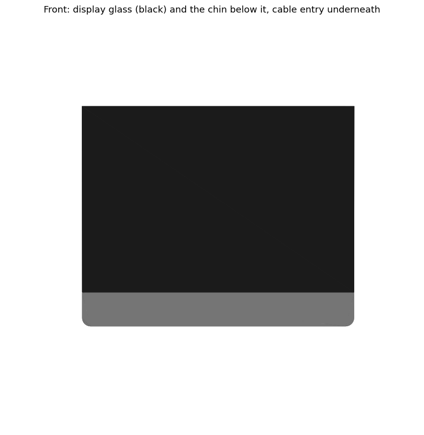
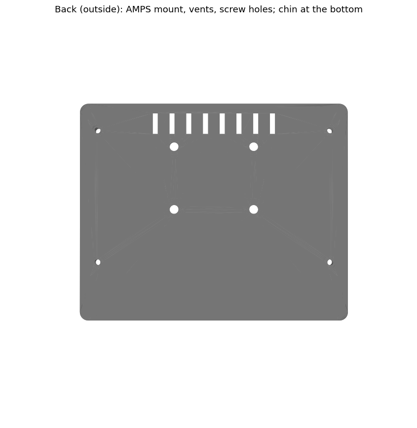
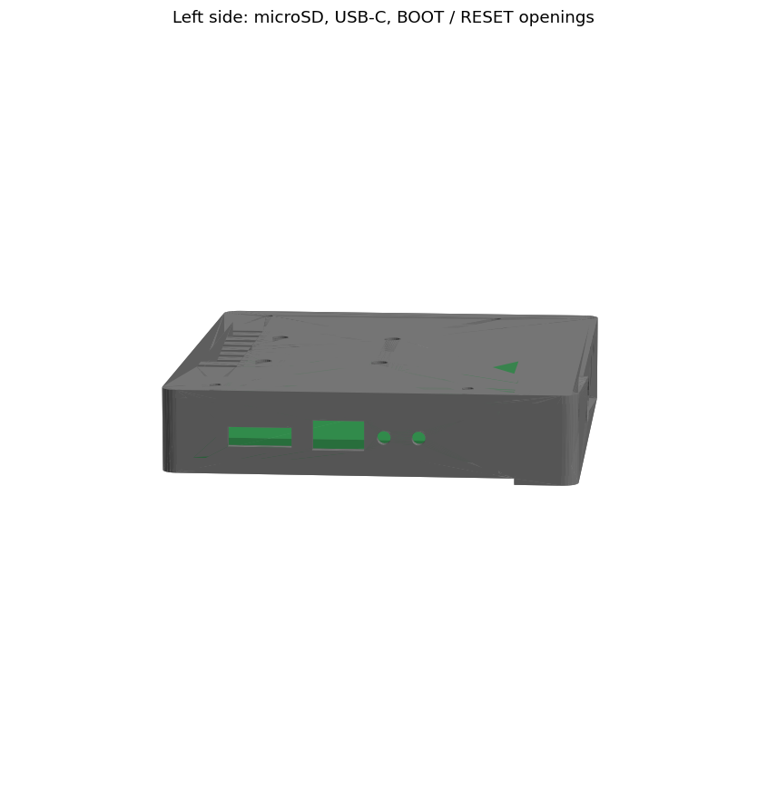
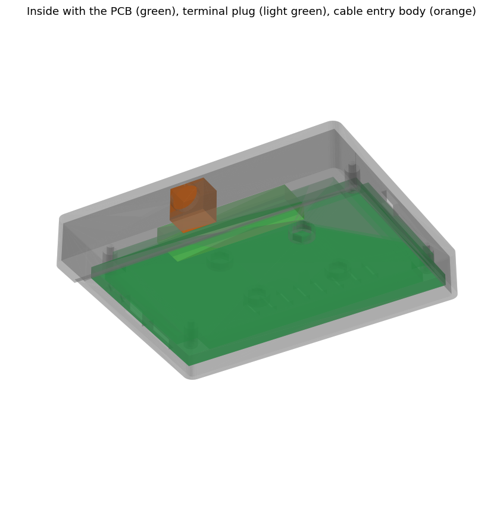

# OBD_Dash back cover (FreeCAD)

A 3D-printable back cover for the Waveshare **ESP32-S3-Touch-LCD-5** (800x480).
It turns the bare display module into a dash unit with:
- a cable entry for the car (power + CAN);
- openings for USB-C, microSD, BOOT / RESET and the battery switch, so the
  cover never has to come off for flashing or the SD card;
- a standard mount pattern on the back.

Same approach as the 7" cover in `FP_Dash/CAD`: a FreeCAD macro builds the
model from a parameter table, checks it against the display, and exports it.

| File | |
|---|---|
| `obd_dash_cover.py` | The model as a FreeCAD macro. It builds everything from a parameter table. |
| `OBD_Dash_Cover.FCStd` | The generated FreeCAD document. Open it in FreeCAD. |
| `export/obd_dash_cover.stl`, `.step` | Ready to slice (STL), or to open in other CAD tools (STEP). |
| `render_preview.py` | Regenerates the pictures in `preview/`. |

| | |
|---|---|
|  |  |
|  |  |

**Status:** generated, not printed yet. Sizes come from Waveshare's dimension
drawing (docs.waveshare.com, ESP32-S3-Touch-LCD-5, touch version) and the
board photo. Values marked **MEASURE** or *estimated* in the spreadsheet are
guesses: measure them first (see *Before you print*).

Overall size: 127.7 x 103.5 mm (glass 87.45 + chin 16), 22.5 mm thick from
the glass front to the back of the cover.

## What the design does

**Fixing to the display.** The PCB is held on the display by 4 M2.5 screws in
its corners (111 x 63 mm apart). The cover has 4 posts that land on the PCB
around those holes. Take the original screws out and use longer M2.5 screws
through the cover, the posts and the PCB into the same standoffs.
- The cover's rim follows the glass outline on the top, left and right, and
  stops 0.5 mm short of the glass.
- A 1 mm foam tape fills that gap, so tightening the screws can't press on
  the glass.

**Inside, seen from behind:**

```
 ┌──────────────────────────────────────────────────┐
 │ o        vents ||||||||                        o │   o = M2.5 screws (PCB corners)
 │SD                                                │
 │USB-C            AMPS  +   +                      │
 │BOOT                                         batt.│
 │RESET                  +   +                switch│
 │ o     [====== green terminal plug ======]      o │
 ├──────────────────────────────────────────────────┤ <- glass bottom edge
 │  chin: wire bend          (O) cable entry        │
 └──────────────────────────────────────────────────┘
```

- **Chin.** The green terminal plug takes its wires from the board's bottom
  edge. That edge is only ~5.75 mm from the glass edge, too little to bend a
  wire. So the cover extends 16 mm below the glass. The chin reaches forward
  to the glass front, and from the front it looks like a lip under the screen.
  The cable comes in through its bottom face.
- **Cable entry.** Default hole: 12.2 mm, which fits an **M12 cable gland** or
  a **GX12 4-pin** panel connector.
  - The pluggable terminal block is already a disconnect point: pull the green
    plug and the dash comes out. So a cable gland is enough.
  - For a GX12 (its solder cups are ~22 mm long inside), set `chin_h` to about
    26 and `con_body_l` to 22. The check tells you if it fits.
- **Side openings.**
  - Left wall: microSD slot (room for a fingernail), USB-C (for flashing), and
    two pin holes for BOOT and RESET.
  - Right wall: the battery on/off switch.
- **AMPS mount:** 4 x M4 holes, 30 x 38 mm, with M4 nut traps inside. This is
  the standard pattern of RAM-style ball mounts and many phone/tablet car
  holders.
- **Vents:** a row of slots at the top.

Not on this cover (compared with the 7"):
- **No 12 V → 5 V converter.** The 5" board has a 6–36 V input (VIN on the
  terminal) with its own buck converter (SY8293, 5 V / 2 A), a reverse-polarity
  diode and a 36 V TVS diode.
- **No service hatch.** The side openings replace it.
- **No battery bay by default.** There's no room above the parts, and a LiPo
  doesn't belong in a hot car (see below). `BUILD_BATTERY_BAY = True` adds one;
  then raise `depth_in` by ~4 mm.

## Wiring to the car

4 wires through the cable entry, to the green terminal plug:

| Car | Terminal pin | |
|---|---|---|
| **KL15** (+12 V switched by the ignition) | **VIN** | 1 A fuse at the car side |
| **KL31** (ground) | **GND** | the one next to VIN |
| CAN-H | **CAN-H** | twisted pair with CAN-L |
| CAN-L | **CAN-L** | |

- The board's input takes 6–36 V and is protected against reverse polarity
  and spikes up to 36 V. A fuse at the car side is still needed.
- **CAN termination.** The car's bus is already terminated. Set the board's
  **120R** termination switch (the small DIP switch marked CAN / RS-485,
  right of the terminal) to **OFF** for CAN in a car. ON is only for a bench
  setup whose bus has no termination of its own.
- **KL30** (permanent +12 V) is only worth a 5th wire if you later want the
  dash to stay on briefly after ignition off, to close the log files cleanly.
  The firmware flushes the logs every 2 s, so KL15 alone is safe enough.

## Battery: optional, and better left out in the car

- A LiPo must not be charged above about 45 °C. A parked car in the sun gets
  far hotter.
- No benefit in the car: the dash runs from KL15 anyway.

For bench or portable use: a 1-cell 3.7 V LiPo with the board's battery plug.
**Check the plug polarity against the board's markings before plugging it in.**

## Before you print

1. **Measure with calipers** and enter the values in the spreadsheet:

   | Parameter | What to measure |
   |---|---|
   | `glass_t` | glass thickness |
   | `front_to_pcb` | glass front → PCB surface on the parts side (drawing: 10.0) |
   | `front_to_parts` | glass front → top of the tallest part, terminal plug excluded (drawing: 14.0) |
   | `front_to_term` | glass front → top of the green terminal plug, plugged in (estimated 17) |
   | `orig_screw_l` | thread length of one original M2.5 PCB screw (under the head) |
   | `sd_dy`, `term_x0`, `term_w` | microSD slot and terminal plug positions (estimated from the photo) |

2. **Screw length:** the spreadsheet computes `screw_len` = original thread +
   cover back + post. **Round it down, never up:** too long a screw goes past
   the standoff and can press into the LCD. With a 5 mm original screw that's
   17.5 mm, so buy **M2.5x16**.
3. Rebuild and check: `freecad.cmd CAD/obd_dash_cover.py`.
   - It prints the gaps and a collision check of the cover against the glass,
     LCD, PCB, parts, terminal plug, cable entry and screw heads.
   - It must end with `CHECK OK`.
   - It also rewrites the STL/STEP files. `freecad.cmd CAD/render_preview.py`
     updates the pictures.
4. **Test print first:** print only the first 5 mm of the cover (stop the
   print early). Check the rim, the posts and the side openings against the
   real display.

**Printing:**
- **Material: PETG at least, ASA/ABS better.** PLA softens at about 55 °C and
  will warp in a parked car.
- Orientation: back face on the bed. The side openings and the cable entry are
  small enough to bridge. Supports are only needed under the chin's front lip,
  if your slicer asks.
- Settings: 0.2 mm layers, 4 walls, 25–30 % infill.

**Parts list:**
- 4 x M2.5x16 (see screw length above)
- 4 x M4x10 + 4 x M4 nuts (mount)
- ~35 cm of 1 mm foam tape, 5 mm wide (rim: top, left and right edges)
- M12 cable gland (or a GX12 4-pin connector, with a deeper chin)
- 4-core cable; twist CAN-H / CAN-L. A 1 A fuse holder for KL15.

## Using and changing the model

Open `OBD_Dash_Cover.FCStd`. The model tree on the left:
- **Params:** the spreadsheet with every size.
- **Reference_display:** blue boxes standing in for the glass, LCD, PCB,
  parts, terminal plug, cable entry and screw heads. They are not printed.
  Their only job is to check that the cover fits around them.
- **Cover:** the printed part. Expand it to see how it is made:
  `Cover = Cover_body − Cover_holes`, `Cover_body = Shell + posts + bosses`,
  and `Shell = Outer − Inner`. `Outer` is the glass-sized body plus the chin.

**Change something:** double-click **Params**, change a value (e.g. `chin_h`
from 16 to 26), close the sheet and press **Ctrl+R**.

The FreeCAD walk-through and the exercises in `FP_Dash/CAD/README.md` apply
here unchanged: same structure, same spreadsheet approach.

The macro is ordinary Python and is meant to be read:
- the parameter table is at the top;
- `build()` creates the features, each with a comment;
- the switches `BUILD_BATTERY_BAY`, `BUILD_VENTS` and `BUILD_AMPS` turn parts
  on and off.

Running it again recreates `OBD_Dash_Cover.FCStd` and the exports, so any hand
edits made in that file are lost. Either change the macro and rerun it, or
stop using the macro and continue by hand in FreeCAD.
